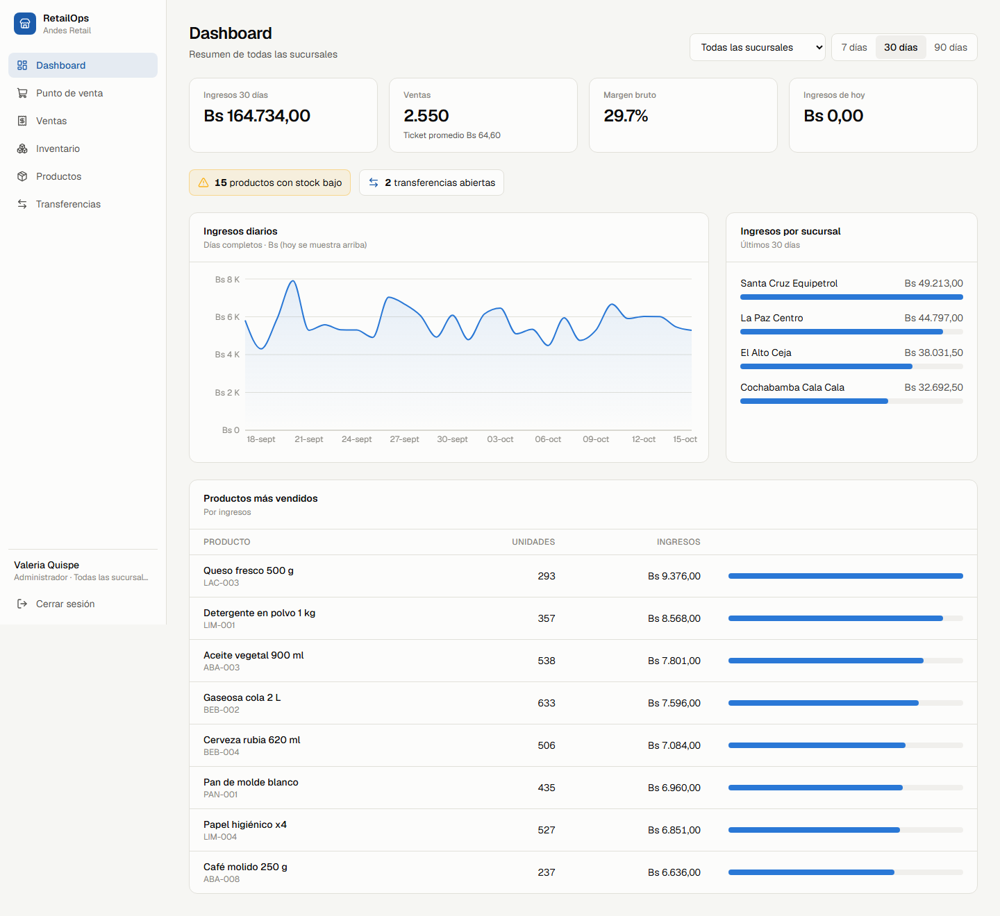
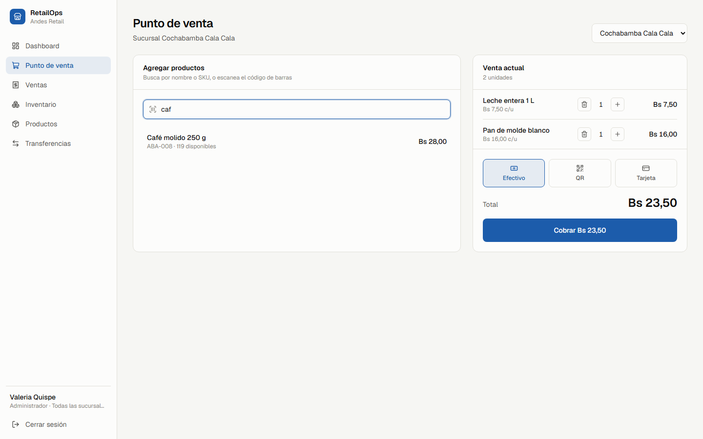
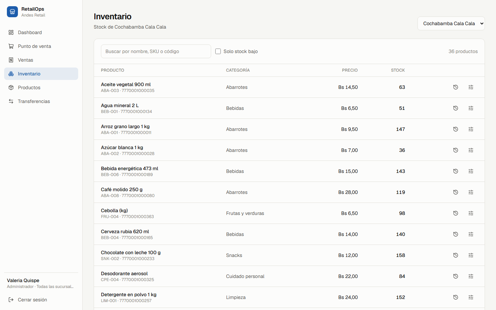
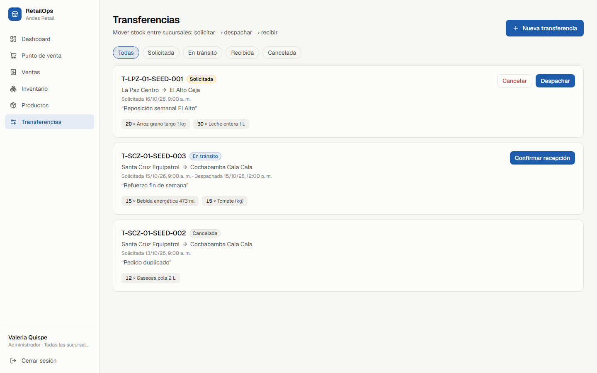
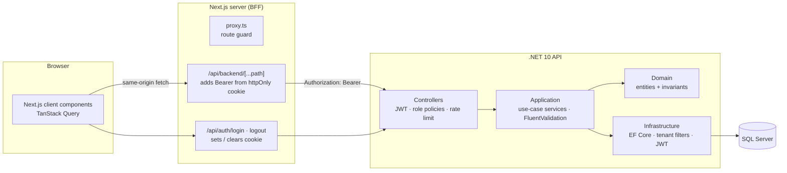

# RetailOps — Multi-store inventory & POS

> Part of the **Andes Retail** portfolio: a fictional Bolivian grocery chain whose systems are built across several projects.
> RetailOps is the operational core; the mobile scanner, the data lakehouse and the AI agents all build on its API and database.

A multi-tenant SaaS for running a chain of stores: point of sale, per-store inventory with a full stock ledger, inter-store transfers, and a sales dashboard. The UI is in Spanish (the "client" is in Bolivia), and amounts are in bolivianos (Bs).

**Stack:** .NET 10 · ASP.NET Core · EF Core 10 · SQL Server 2022 · Next.js 16 (App Router, React 19) · TanStack Query · Tailwind CSS 4 · xUnit + Testcontainers · Playwright · Docker · GitHub Actions



| Point of sale | Inventory | Transfers |
|---|---|---|
|  |  |  |

---

## The problem

Andes Retail runs four stores in La Paz, El Alto, Cochabamba and Santa Cruz. Before RetailOps, each store kept stock in its own spreadsheet. That caused three recurring problems:

1. **Overselling.** A product showed as available after its last unit had been sold at another till.
2. **Stock lost "in transit".** Goods sent between stores were deducted at the origin when requested and never reliably added at the destination.
3. **No shared view of the business.** Head office only saw revenue per store once a week.

## What it does

| Area | Capability |
|---|---|
| **POS** | Search by name/SKU or scan an EAN-13 barcode, build a cart, pick cash / QR / card payment, and get a receipt. Stock is checked and decremented atomically. |
| **Inventory** | Stock per store, low-stock flags (reorder point), supplier receipts, signed adjustments, and an append-only **movement ledger** for every unit that moves. |
| **Physical counts** | Idempotent count submission (`clientCountId`) built for the offline-first mobile scanner (project #2). A retried sync never double-adjusts. |
| **Transfers** | `Requested → InTransit → Received` (or `Cancelled` before shipping). Stock leaves the origin only on *ship* and enters the destination only on *receive*. |
| **Dashboard** | Revenue, ticket count, average ticket, gross margin, daily revenue trend, revenue by store and top products, filterable by store and by 7/30/90 days. |
| **Multi-tenancy** | Two seeded tenants (`Andes Retail`, `Altiplano Market`) share one database and never see each other's data. |
| **Roles** | **Admin** (all stores), **Manager** (one store: adjustments, transfers, catalog), **Cashier** (one store: sells and views stock). |

## Architecture



The backend follows Clean Architecture. Dependencies point inward: `Api → Infrastructure → Application → Domain`.

```
backend/
  src/RetailOps.Domain          Entities and business rules (no framework dependencies)
  src/RetailOps.Application     One service per feature, DTOs, validators, authorization helpers
  src/RetailOps.Infrastructure  EF Core DbContext, configurations, migrations, JWT, demo seeder
  src/RetailOps.Api             Controllers, auth, ProblemDetails mapping, OpenAPI (Scalar)
  tests/RetailOps.UnitTests         Domain rules
  tests/RetailOps.IntegrationTests  Real HTTP + real SQL Server (Testcontainers)
frontend/
  src/proxy.ts                  Optimistic route guard
  src/app/api/**                BFF route handlers
  src/app/(app)/**              Dashboard, POS, sales, inventory, products, transfers
  e2e/                          Playwright end-to-end tests and screenshot capture
```

## Engineering decisions

**Overselling is prevented at the database level, not by hope.**
`StockLevel` carries a SQL Server `rowversion`. A sale loads the stock rows, applies `Decrease()` (which refuses to go below zero), and saves the sale, its lines, the stock changes and the ledger entries in one `SaveChanges`, which is one transaction. If two tills sell the last unit at the same moment, the second write fails the concurrency check and returns **409**. A `CHECK (Quantity >= 0)` constraint backs this up. The integration test `Concurrent_sales_of_the_last_unit_never_oversell` fires four parallel sales at a product with one unit left and asserts that exactly one succeeds.

**Business rules live in the domain.**
`Transfer` is a small state machine: you cannot receive before shipping, cancel after shipping, or ship an empty transfer. `Sale.AddLine` captures the price at the moment of sale, so later price changes don't rewrite history. These rules are unit-tested without a database.

**Tenant isolation is automatic, not remembered.**
Every tenant-scoped entity gets an EF Core global query filter bound to the caller's `tenant_id` claim. `SaveChanges` stamps new rows with that tenant and **throws on any cross-tenant write**. Reading another tenant's record by id returns 404, never 403, so the API doesn't even confirm the record exists. The one intentional bypass is login, which has to find the user before the tenant is known.

**Store-level authorization is separate from roles.**
A role says *what* you can do; `ICurrentUser.EnsureCanOperate(storeId)` says *where*. A La Paz manager can create a transfer *into* La Paz, but only the origin store can ship it and only the destination can receive it.

**The JWT never reaches browser JavaScript.**
The Next.js server acts as a Backend-for-Frontend. Login stores the token in an `httpOnly`, `SameSite=Lax` cookie. Client code calls `/api/backend/*` on its own origin, and the route handler forwards the call to the API with the bearer token. An XSS bug can't read the token, and the API needs no public CORS surface.

**One error shape everywhere.**
Domain, validation, authorization and concurrency exceptions map to RFC 9457 `ProblemDetails`:

| Status | Meaning |
|---|---|
| 400 | Validation failed, with per-field errors that the forms display inline |
| 401 / 403 | Not authenticated / not allowed |
| 404 | Not found, or belongs to another tenant |
| 409 | Concurrency conflict |
| 422 | Business rule violated, with a stable `code` such as `inventory.insufficient_stock` |

**The ledger always reconciles.**
`StockMovement` is append-only. The demo seeder chooses current stock first and back-calculates the opening receipt, so `SUM(movements) == current quantity` holds for every product in every store. That property is what makes this database a trustworthy source for the analytics lakehouse (project #5).

**Data the next projects can rely on.**
Enums are stored as readable strings, barcodes are valid EAN-13 with Bolivia's GS1 prefix `777`, and timestamps are UTC with business days bucketed at UTC−4.

**Other production details.**
- Login is rate-limited per IP (10/min). Behind the BFF, `X-Forwarded-For` is trusted from exactly one hop.
- `/health` checks the database.
- The API applies migrations and seeds on startup (configurable).
- Docker images are multi-stage, run as non-root, and the Next.js image uses `standalone` output.

## Testing

| Layer | Tool | What it covers |
|---|---|---|
| Domain | xUnit (18 tests) | Stock can't go negative, transfer state machine, sale totals, price capture |
| API + DB | xUnit + Testcontainers SQL Server (14 tests) | Auth, tenant isolation, role and store authorization, sales and ledger, oversell → 422, concurrent last-unit sale, transfer flow, idempotent counts, validation errors |
| UI | Playwright (5 tests) | Route guard, failed login, cashier completes a POS sale and stock drops, manager low-stock filter, tenant isolation in the UI |

```bash
cd backend && dotnet test                         # needs Docker for Testcontainers
cd frontend && npx playwright test --project desktop
```

CI (`.github/workflows/ci.yml`) has three jobs:
- **backend**: build with warnings as errors, then run all tests.
- **frontend**: lint, typecheck, build.
- **e2e**: start the full stack with Docker Compose and run Playwright against it.

## Run it

**Option A: everything in Docker**

```bash
docker compose up --build
```

- Web: http://localhost:3000
- API docs (Scalar): http://localhost:8080/scalar

**Option B: local development**

```bash
docker compose up -d sqlserver
cd backend && dotnet run --project src/RetailOps.Api --urls http://localhost:5080
cd frontend && npm install && npm run dev        # API_URL defaults to http://localhost:5080
```

**Demo accounts** (password `Demo2026!`; the login screen has one-click buttons for the first four):

| User | Role | Scope |
|---|---|---|
| `admin@andesretail.demo` | Admin | All 4 stores |
| `gerente.lpz@andesretail.demo` | Manager | La Paz Centro (also `.eal`, `.cba`, `.scz`) |
| `cajero.lpz@andesretail.demo` | Cashier | La Paz Centro (also `.eal`, `.cba`, `.scz`) |
| `admin@altiplano.demo` | Admin | A second tenant, for testing isolation |

The seeder creates 36 products, about 45 days of realistic sales history (weighted by product popularity, with weekend peaks), and one transfer in each state.

## API overview

| Method | Path | Who |
|---|---|---|
| `POST` | `/api/auth/login` | Anyone (rate-limited) |
| `GET` | `/api/auth/me` | Authenticated |
| `GET` / `POST` | `/api/stores` | All / Admin |
| `GET` | `/api/stores/{id}/stock?search=&lowOnly=` | Own store (Admin: any) |
| `GET` | `/api/stores/{id}/stock/barcode/{ean}` | Own store |
| `POST` | `/api/stores/{id}/stock/adjustments` | Manager, Admin |
| `POST` | `/api/stores/{id}/stock/counts` | Own store, idempotent |
| `GET` | `/api/stores/{id}/movements` | Own store |
| `GET` / `POST` / `PUT` | `/api/products` | All / Manager, Admin |
| `GET` | `/api/products/barcode/{ean}` | All |
| `GET` / `POST` | `/api/sales` | Scoped to own store |
| `GET` / `POST` | `/api/transfers`, `/{id}/ship`, `/{id}/receive`, `/{id}/cancel` | Manager (involved store), Admin |
| `GET` | `/api/reports/dashboard?days=&storeId=` | Scoped to own store |

The interactive reference is at `/scalar`; the OpenAPI document is at `/openapi/v1.json`.

## What I'd do next

- **Refresh tokens and revocation.** Tokens currently last 8 hours with no server-side logout.
- **Outbox and domain events.** Publish `SaleCompleted` and `TransferReceived` for downstream consumers instead of having them poll the database.
- **Pre-aggregated daily sales.** The dashboard aggregates on request, which is fine at this volume but would move to a summary table at scale.
- **Audit trail on catalog edits** (who changed a price, and when).
